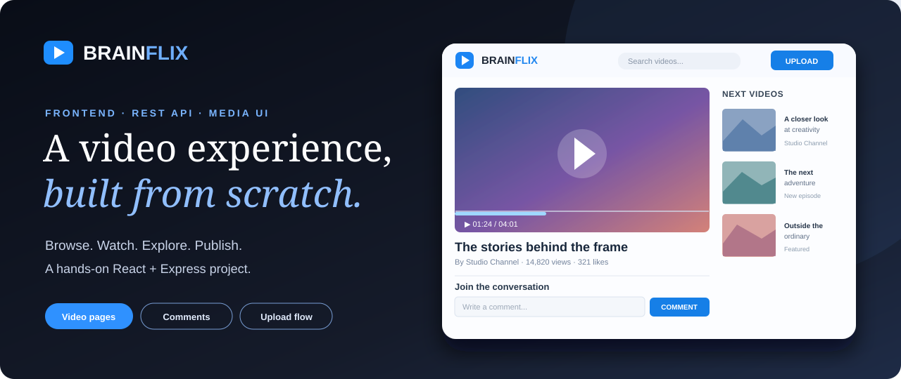
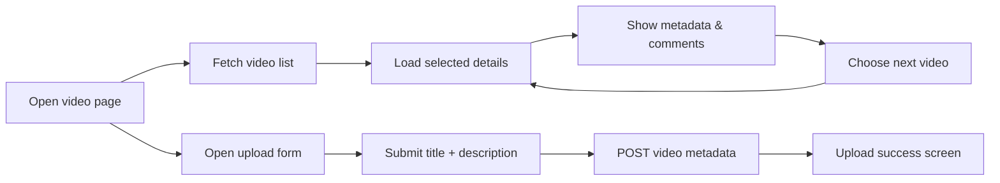
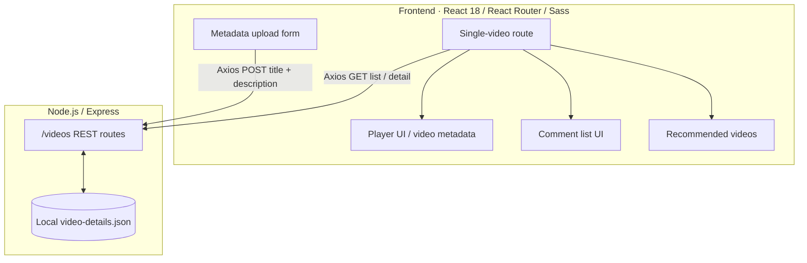

<div align="center">
  
  <h1>Brainflix</h1>
  <p><strong>A video experience, built from scratch.</strong></p>
  <p>A hands-on video-platform project featuring dynamic video detail pages, recommendations, a comment interface, and a Node.js / Express API.</p>
  <p><strong>Independently hand-coded · Pre-AI-assisted development portfolio project</strong></p>
  <p><a href="#features">Explore features</a> · <a href="#architecture">Architecture</a> · <a href="#run-locally">Run locally</a></p>
  <p>
    
    
    
    
  </p>
</div>

> **Portfolio note:** This is a historical project written by hand before AI coding assistants became part of my development workflow. The cover is an **original illustrative product graphic**, not an application screenshot. The project is a learning/portfolio implementation—not a commercial video-hosting service.

---

## The idea

A video platform looks straightforward from the outside: click a thumbnail, watch a video, read the details, explore what's next. But even that familiar experience brings together routing, shared components, asynchronous data fetching, content layout and a backend API.

**Brainflix was my way of building those pieces myself.**

The project pairs a responsive, component-based React interface with a lightweight Express service. Visitors can move between video detail pages, browse recommended videos and view existing comments; a separate publishing form submits new video *metadata* to the server.

## Features

| Experience | Implementation |
| --- | --- |
| **Video detail page** | Dynamic routes such as <code>/videos/:id</code> and API-driven details including title, channel, date, views, likes and description. |
| **Video library navigation** | A "Next Videos" sidebar populated from the video-list endpoint; selecting another entry changes the viewed video. |
| **Player presentation** | An HTML5 video-player element with controls and a poster, laid out alongside information and recommendations. |
| **Comments display** | Comment count, comment cards, author names and relative dates from video data; the comment-entry form is **visual only**. |
| **Publishing workflow** | A separate <code>/upload</code> form with required title/description fields, API submission, and a success route. |
| **Lightweight REST API** | Express routes that list videos, return one video's details, and add a new metadata record with a generated UUID. |
| **Responsive styling** | Hand-written Sass modules and shared React components for a multi-screen video UI. |

### Explore → watch → publish



### Original interface assets

<div align="center">
  
  <p><small>Logo asset from the original React frontend repository. The illustrated banner above represents the intended layout, rather than a live screenshot.</small></p>
</div>

## What I implemented

This project was built through traditional, hands-on frontend and backend development rather than AI-generated code:

- **Component architecture:** separated the player, video metadata, comments, recommendations, header and upload flow into reusable React components.
- **Route-based navigation:** used React Router for the main video screen, individual video IDs, upload flow and success page.
- **Asynchronous requests:** fetched the video list and selected video's detail with Axios, using React state and effects to update the page.
- **Express endpoints:** implemented <code>GET /videos</code>, <code>GET /videos/:id</code> and <code>POST /videos</code>.
- **File-backed data storage:** read and updated local JSON records through Node.js filesystem APIs, generating IDs with UUID.
- **Responsive visual design:** used Sass partials and modular component styles to structure the layout.

## Architecture



| Layer | Technology | Purpose |
| --- | --- | --- |
| Frontend | React 18, JavaScript, React Router 6 | Components and navigation |
| Styles | Sass / SCSS | Layout, mixins and responsive styles |
| API client | Axios | Load videos and submit metadata |
| Backend | Node.js, Express 4, CORS | Video endpoints |
| Persistence | JSON file + Node.js <code>fs</code> | Store example videos and uploaded metadata |
| Identifiers | UUID | Generate IDs for new records |

### API overview

| Method | Route | Behavior |
| --- | --- | --- |
| <code>GET</code> | <code>/videos</code> | Returns summary entries for video navigation. |
| <code>GET</code> | <code>/videos/:id</code> | Returns a matching video's detail record. |
| <code>POST</code> | <code>/videos</code> | Adds a record using a title, description and preset demo metadata. |

**Scope:** "Upload" means **creating a video metadata record**, not transferring a video file or transcoding/hosting media. The video-player component has no source URL wired to its <code>&lt;video&gt;</code> element in the inspected code. Likewise, the comment form does not include a submission handler or comment-write endpoint. Those features should not be mistaken for a complete streaming platform.

## Source repositories

The portfolio repository you're viewing is an **umbrella repository** that tracks the original frontend and backend projects using Git entries:

| Source | What's inside |
| --- | --- |
| **[React frontend](https://github.com/roxanehe/ruoxin-he-brainflix)** | Views, routes, components, SCSS, UI assets and API requests |
| **[Express backend](https://github.com/roxanehe/ruoxin-he-brainflix-api)** | Video endpoints and JSON-file storage |
| **[Portfolio wrapper](https://github.com/Roxyh-code/Brainflix)** | Historical references to both projects and this README |

**Repository-history caveat:** The wrapper does not include a usable <code>.gitmodules</code> configuration, and one of its pinned backend commit IDs could not be resolved in the public API repository. For a reproducible local run, **clone the accessible frontend and backend source repositories directly** rather than relying on the wrapper to populate its linked directories.

## Run locally

**Requirements:** Node.js and npm. This is an older Create React App project; newer Node versions may need compatibility work.

**Terminal 1 — Backend:**

```bash
git clone https://github.com/roxanehe/ruoxin-he-brainflix-api.git
cd ruoxin-he-brainflix-api
npm install
PORT=8000 node index.js
```

Windows PowerShell equivalent for the last command:

```powershell
$env:PORT = "8000"
node index.js
```

**Terminal 2 — Frontend:**

```bash
git clone https://github.com/roxanehe/ruoxin-he-brainflix.git
cd ruoxin-he-brainflix
npm install
npm start
```

Open <code>http://localhost:3000</code>. The frontend source references the backend at <code>http://localhost:8000/videos</code>. The backend runs with a JSON fixture file rather than a database.

To build the frontend:

```bash
npm run build
```

> **Historical-source note:** The source code contains some case mismatches between import names and actual file names (for example the single-video and upload-success components). On case-sensitive operating systems, resolve these mismatches before expecting a successful build. The original backend <code>npm run dev</code> script references a nonexistent <code>server.js</code>; use <code>node index.js</code> as shown above. These limitations are not hidden or represented as validated test passes.

## Project structure

```text
Brainflix/                      # Portfolio wrapper
├── README.md                   # This documentation
├── docs/assets/                # Original README illustration
├── ruoxin-he-brainflix         # Gitlink to React frontend
└── ruoxin-he-brainflix-api     # Gitlink to Express API

Original React frontend:
├── src/components/             # Player, metadata, comments, upload
├── src/pages/Singlevideo.jsx   # Video detail route
├── src/styles/                 # Sass variables and mixins
└── src/assets/                 # Existing icons and images

Original API:
├── index.js                    # Express app
├── routes/video.js             # GET/POST endpoints
└── data/video-details.json     # JSON fixture and local writes
```

## What I learned

Brainflix helped me practice the fundamentals of full-stack web development: how to design a multi-page UI, keep components responsible for one thing, fetch data from a server, coordinate route state, and persist a submitted record.

It was a **hand-coded engineering exercise**. Its value is in the implementation work and the technical foundations it demonstrates, not a claim to have built a fully operational streaming service.

---

Explore the [React source](https://github.com/roxanehe/ruoxin-he-brainflix), the [Express API](https://github.com/roxanehe/ruoxin-he-brainflix-api) or this project's [issue tracker](https://github.com/Roxyh-code/Brainflix/issues).
